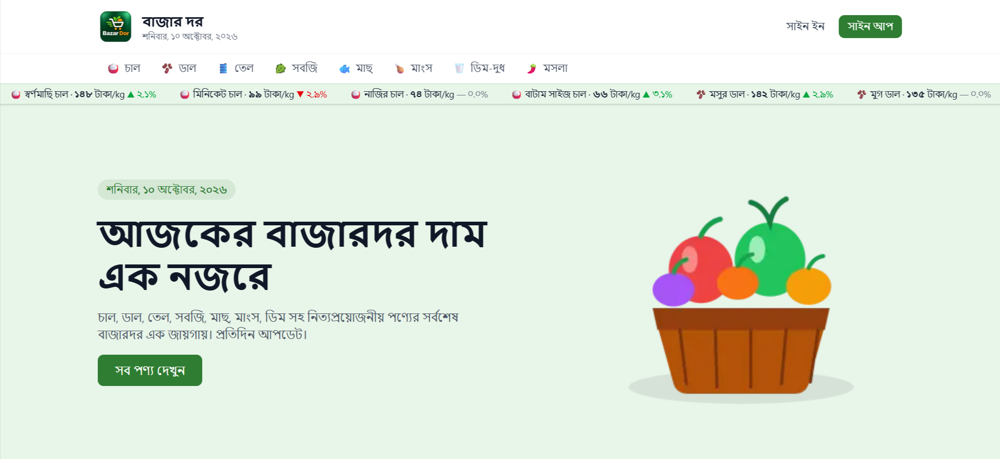
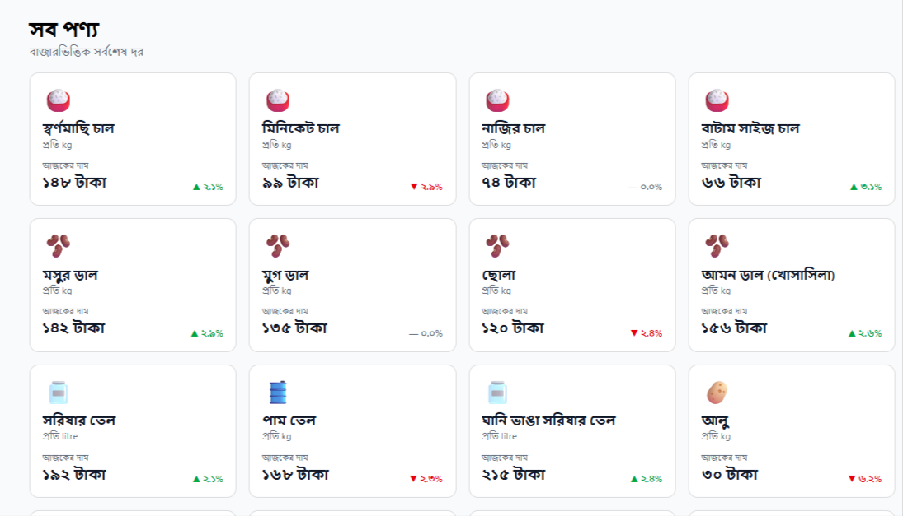
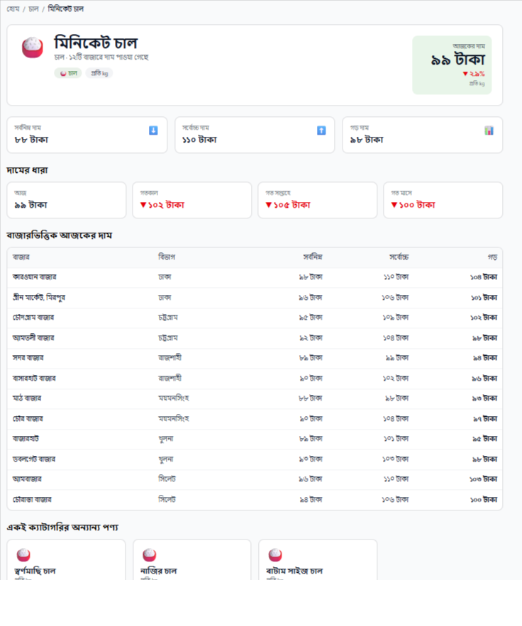
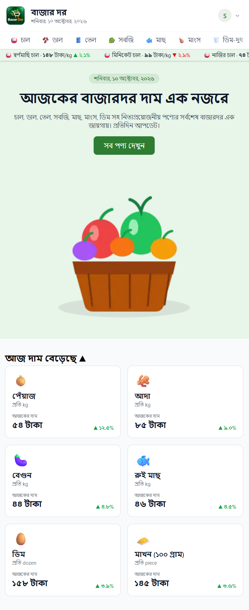
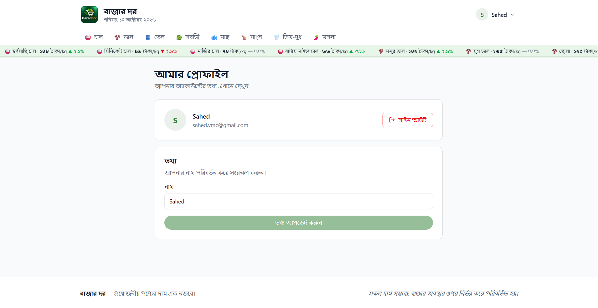
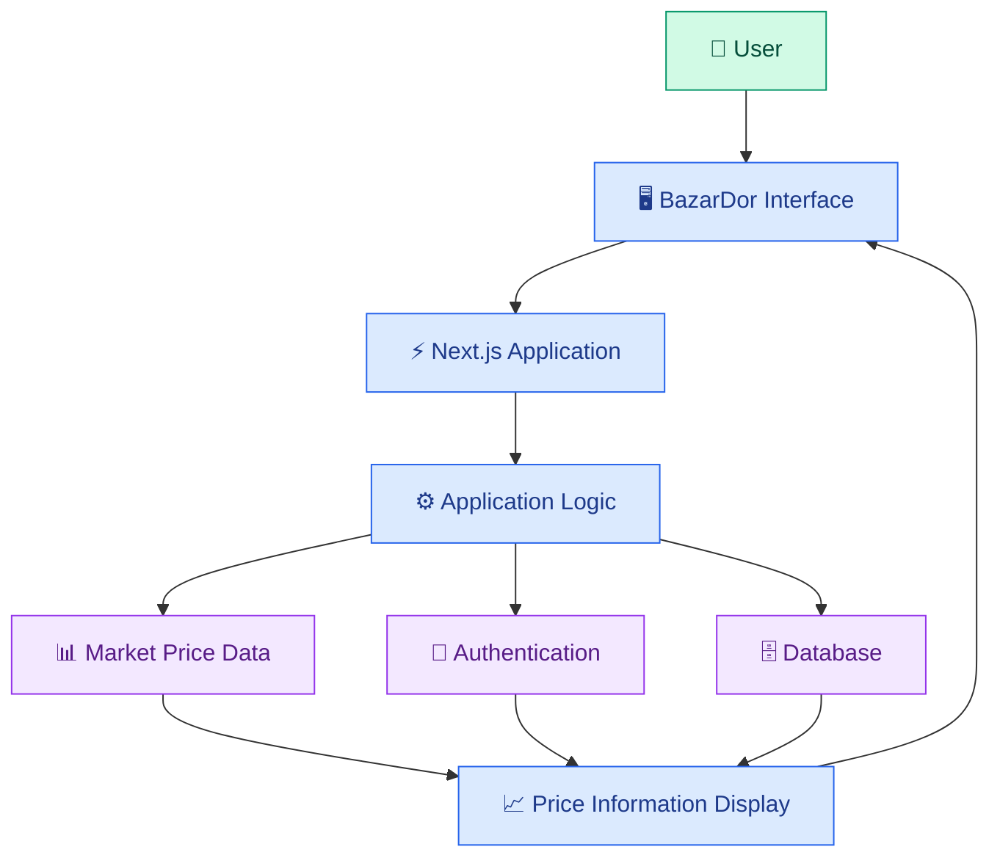

<div align="center">


<br/>

<a href="https://bazar-dor-blush.vercel.app/">

</a>
<a href="https://github.com/IamSahedRana/BazarDor">

</a>

<br/><br/>


<br/><br/>

**A modern market price-tracking platform built to make everyday price information easier to explore, compare, and understand.**

[Live Website](https://bazar-dor-blush.vercel.app/) · [Source Code](https://github.com/IamSahedRana/BazarDor) · [Report an Issue](https://github.com/IamSahedRana/BazarDor/issues)

</div>


---

## 📖 About BazarDor

**BazarDor (বাজার দর)** is a market price-tracking web application focused on making price information easier to access and understand.

Market prices can change, and finding useful information across different sources can be inconvenient. BazarDor aims to provide a convenient digital experience for exploring market-related product information and understanding price trends.

The project combines modern web technologies with a clean interface to deliver a practical market information experience.

<div align="center">

| 🌐 Live Application | 💻 Open Source Repository |
|:---:|:---:|
| [Visit BazarDor](https://bazar-dor-blush.vercel.app/) | [Explore on GitHub](https://github.com/IamSahedRana/BazarDor) |

</div>

---

## 🎯 Project Objectives

- Make market price information easier to explore.
- Present product and market information in an accessible interface.
- Help users understand available market trends.
- Build a responsive experience across desktop and mobile devices.
- Apply modern frontend development practices.
- Develop and deploy a real-world web application.

---

## ✨ Features

<div align="center">

<table>
<tr>
<td width="50%" valign="top">

### 📊 Market Price Tracking

Explore available market price information through the application.

</td>
<td width="50%" valign="top">

### 📈 Market Trends

View market-related information and trends where supported.

</td>
</tr>
<tr>
<td width="50%" valign="top">

### 🔐 Authentication

Authentication functionality for accessing supported user features.

</td>
<td width="50%" valign="top">

### 🛍️ Product Information

Explore product-related market information available in the application.

</td>
</tr>
<tr>
<td width="50%" valign="top">

### 📱 Responsive Interface

A modern layout designed for different screen sizes.

</td>
<td width="50%" valign="top">

### ⚡ Modern Architecture

Built using Next.js, React, and TypeScript.

</td>
</tr>
</table>

</div>

---

## 🖼️ Visual Gallery

<div align="center">

<table>
<tr>
<td width="50%">

<p align="center"><strong>Main Interface</strong></p>
</td>
<td width="50%">

<p align="center"><strong>Market Information</strong></p>
</td>
</tr>
<tr>
<td width="50%">

<p align="center"><strong>Product Exploration</strong></p>
</td>
<td width="50%">

<p align="center"><strong>Mobile Experience</strong></p>
</td>
</tr>
</table>

</div>

---


## 📸 Project Showcase

<div align="center">

### 🏠 Home Page

<a href="https://bazar-dor-blush.vercel.app/">

</a>

*Explore the BazarDor experience through its main interface.*

<br/>

### 📊 Market Prices & Trends


*Explore available market price information and trends.*

<br/>

### 🛍️ Product Exploration


*Browse product information through the application interface.*

<br/>

### 🔐 Authentication



*User authentication interface.*

<br/>

### 📱 Responsive Design


*An interface designed to accommodate different screen sizes.*

</div>

> **Screenshot setup:** Save screenshots of your actual application inside `public/screenshots/` using the filenames shown above. Replace or remove any screenshot section that does not match an existing feature. These relative paths will display your images directly on GitHub.


---

## 🛠️ Technology Stack

<div align="center">

### Frontend Development

<p>
  
</p>

### Backend & Database

<p>
  
</p>

### Tools & Deployment

<p>
  
</p>

</div>

### Technology Overview

<div align="center">

| Technology | Purpose |
|:---|:---|
| **Next.js** | Application framework and routing |
| **React** | Component-based user interfaces |
| **TypeScript** | Type-safe application development |
| **Tailwind CSS** | Responsive interface styling |
| **MongoDB** | Database, if configured |
| **Better Auth** | Authentication, if configured |
| **HeroUI** | UI components, if used |
| **Git & GitHub** | Version control and collaboration |
| **Vercel** | Hosting and deployment |

</div>

---

## 🧩 Application Architecture

BazarDor uses a modern web application architecture centered around its Next.js interface and supporting application services.



<sub>Conceptual overview. Actual integrations depend on the services implemented and configured in the repository.</sub>

---

## 📁 Project Structure

The following is an illustrative overview of the project. Keep the directory names aligned with your actual repository.

```text
BazarDor/
├── public/
│   └── screenshots/
│       ├── homepage.png
│       ├── market-prices.png
│       ├── products.png
│       ├── authentication.png
│       └── mobile-view.png
│
├── src/
│   ├── app/
│   │   ├── layout.tsx
│   │   ├── page.tsx
│   │   └── globals.css
│   │
│   ├── components/
│   │   └── ... 
│   │
│   └── ... 
│
├── .gitignore
├── eslint.config.mjs
├── next.config.ts
├── package.json
├── package-lock.json
├── tsconfig.json
└── README.md
```

### Directory Guide

| Directory / File | Description |
|:---|:---|
| `public/` | Static assets and images |
| `public/screenshots/` | README project screenshots |
| `src/app/` | Application routes, layouts and styles |
| `src/components/` | Reusable UI components |
| `package.json` | Dependencies and npm scripts |
| `next.config.ts` | Next.js configuration |
| `tsconfig.json` | TypeScript configuration |
| `README.md` | Project documentation |

---

## 🚀 Getting Started

Run BazarDor locally with the following steps.

### Prerequisites

- [Node.js](https://nodejs.org/)
- npm
- [Git](https://git-scm.com/)

### 1. Clone the Repository

```bash
git clone https://github.com/IamSahedRana/BazarDor.git
```

### 2. Open the Project

```bash
cd BazarDor
```

### 3. Install Dependencies

```bash
npm install
```

### 4. Configure Environment Variables

Create a `.env.local` file in the root directory if required.

```env
# Add the environment variables required by your project.
# Refer to the existing source code for the exact variable names.
```

Never commit API keys, database credentials or authentication secrets.

### 5. Start the Development Server

```bash
npm run dev
```

Visit [http://localhost:3000](http://localhost:3000).

---

## 📜 Available Scripts

| Command | Description |
|:---|:---|
| `npm run dev` | Start the development server |
| `npm run build` | Create a production build |
| `npm start` | Run the production server |
| `npm run lint` | Run ESLint checks |

<sub>Available commands depend on the scripts defined in package.json.</sub>

---

## 🌐 Live Demo

<div align="center">

### Experience BazarDor

Explore the live application and discover its interface.

<a href="https://bazar-dor-blush.vercel.app/">
  
</a>

<br/><br/>

<a href="https://github.com/IamSahedRana/BazarDor">
  
</a>

</div>

---

## ☁️ Deployment

BazarDor is deployed using [Vercel](https://vercel.com/).

To deploy your own instance:

1. Import the repository into Vercel.
2. Configure the required environment variables.
3. Deploy the project.
4. Verify the live website and required services.

<div align="center">

<a href="https://vercel.com/new/clone?repository-url=https://github.com/IamSahedRana/BazarDor">
  
</a>

</div>

---

## 🔒 Security & Best Practices

- Keep sensitive environment variables private.
- Never commit credentials or API secrets.
- Validate and handle external data appropriately.
- Keep project dependencies updated.
- Configure authentication and database permissions securely.
- Test production configuration before deployment.

---

## 🧪 Quality Checklist

Before releasing updates, verify the following:

- [ ] Application starts successfully.
- [ ] Main routes load correctly.
- [ ] Interface works on desktop and mobile.
- [ ] Authentication works, if implemented.
- [ ] Market data displays correctly.
- [ ] Lint checks pass.
- [ ] Production build completes successfully.
- [ ] Deployment works as expected.

---

## 🗺️ Future Improvements

Potential enhancements for BazarDor include:

- [ ] Expand product and market coverage.
- [ ] Introduce historical price charts.
- [ ] Improve product search and filtering.
- [ ] Add more market trend insights.
- [ ] Improve mobile navigation and accessibility.
- [ ] Improve price data freshness and reliability.
- [ ] Optimise application performance.

---

## 🤝 Contributing

Contributions, suggestions and bug reports are welcome.

1. Fork the repository.
2. Create a feature branch.
3. Implement your changes.
4. Commit and push your work.
5. Open a pull request with a clear description.

For bug reports and feature suggestions, visit
[GitHub Issues](https://github.com/IamSahedRana/BazarDor/issues).

---

## 📚 Resources

<p align="center">
  <a href="https://nextjs.org/docs">Next.js Docs</a> ·
  <a href="https://react.dev/">React Docs</a> ·
  <a href="https://www.typescriptlang.org/docs/">TypeScript Docs</a> ·
  <a href="https://tailwindcss.com/docs">Tailwind CSS Docs</a> ·
  <a href="https://vercel.com/docs">Vercel Docs</a>
</p>

---

## 👨‍💻 Author

<div align="center">


### Abdulla Sahed

Developer of BazarDor

<a href="https://github.com/IamSahedRana">
  
</a>

<a href="https://github.com/IamSahedRana/BazarDor">
  
</a>

</div>

---

<div align="center">


### 🛒 BazarDor

**Making market price information easier to explore.**

If you find this project interesting, consider giving the repository a ⭐.

<a href="https://github.com/IamSahedRana/BazarDor">
  
</a>

<br/><br/>

<sub>Built with ❤️ by Abdulla Sahed</sub>

</div>
